<p align="center">
  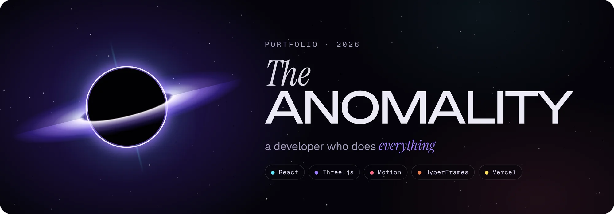
</p>

<p align="center">
  <!-- After deploying, add your live link here, e.g.:
  <a href="https://your-site.vercel.app"><b>🌌 Open the live site</b></a> &nbsp;·&nbsp; -->
  <a href="#the-particle-universe"><b>Particle universe</b></a>
  &nbsp;·&nbsp;
  <a href="#whats-inside">Features</a>
  &nbsp;·&nbsp;
  <a href="#screenshots">Screenshots</a>
  &nbsp;·&nbsp;
  <a href="#quick-start">Quick start</a>
  &nbsp;·&nbsp;
  <a href="#deploy-to-vercel">Deploy</a>
  &nbsp;·&nbsp;
  <a href="#make-it-yours">Make it yours</a>
</p>

<p align="center">
  
  
  
  
  
  
  
  
  
  
</p>

<p align="center">
  A portfolio for a developer who does <i>everything</i>. One WebGL particle system morphs as you scroll: from a black hole, into an atom, into a sakura flower, into a galaxy, into a portal. Two real projects, <b>Atom</b> and <b>AnimeWiki</b>, run live inside it.
</p>

<p align="center">
  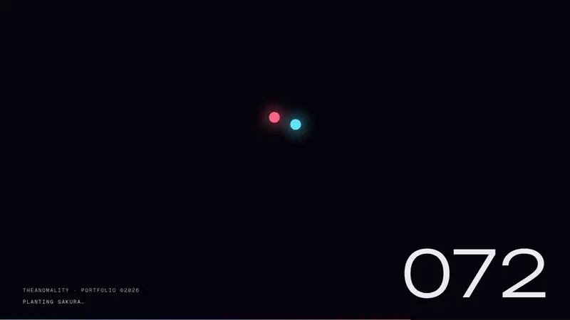
  <br>
  <sub>Preloader → hero → manifesto → the particles become an atom, then sakura, then a portal.</sub>
</p>

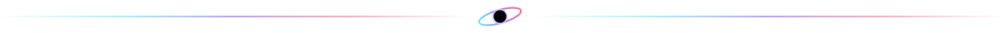

## The particle universe

The whole background is **one particle system** of up to 20,000 points. Each section asks for a shape, and the particles swirl through a flow field to get there.

<p align="center">
  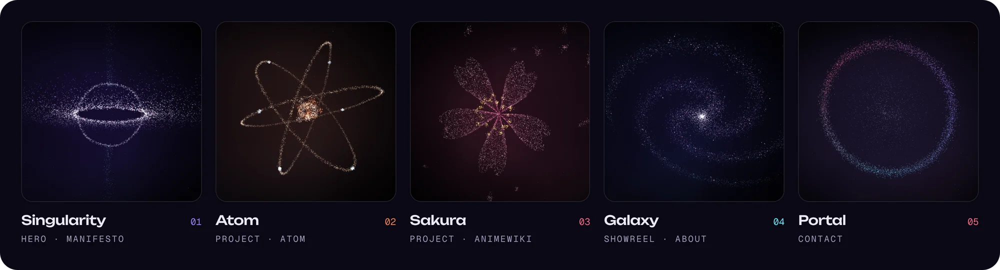
</p>

| | Shape | Shown with | What moves |
| --- | --- | --- | --- |
| 01 | **Singularity** | Hero, manifesto | The accretion disk spins faster near the centre; the photon ring shimmers; jets pulse |
| 02 | **Atom** | The Atom project | Electrons orbit along three tilted rings around a jittering nucleus |
| 03 | **Sakura** | The AnimeWiki project | Five notched petals breathe; loose petals fall and sway |
| 04 | **Galaxy** | Showreel, skills, about | Three spiral arms rotate around a bright core |
| 05 | **Portal** | Contact | The ring turns while the vortex inside spins faster towards its centre |

Move your cursor and the particles scatter away from it. **Click the hero** and the anomaly bursts.

<details>
<summary><b>How the morph works</b> (for the curious)</summary>
<br>

- Every particle stores a position in **all five shapes** (`src/three/shapes.ts`, generated from a seeded random generator so the shapes look identical on every visit).
- The vertex shader (`src/three/shaders.ts`) blends those positions with five weights. A morph is just the weights easing from one shape to the next.
- Each particle gets its own easing curve, so morphs feel staggered rather than uniform. While no shape dominates, a sine-based flow field adds swirl, plus extra turbulence from your scroll speed.
- Cursor repulsion happens in screen space in the shader. The click burst pushes particles out along their position vectors.
- Each shape's own motion (orbits, falling petals, disk rotation) is computed in the shader, so the CPU only updates a handful of uniforms per frame.
- Sections register the look they want (shape, offset, scale, brightness, accent colour) and one `IntersectionObserver` hands the scene to whichever section crosses the middle of the screen.

</details>


## What's inside

<table>
  <tr>
    <td width="33%" valign="top">
      <h3>🪐 Morphing 3D world</h3>
      React Three Fiber and custom GLSL shaders. It adapts to the device: fewer particles on phones, lower resolution when frames drop.
    </td>
    <td width="33%" valign="top">
      <h3>🚀 Projects run inside</h3>
      Atom and AnimeWiki are served at <code>/atom/</code> and <code>/animewiki/</code>. <b>Launch inside portfolio</b> opens them full-screen; Back closes them.
    </td>
    <td width="33%" valign="top">
      <h3>🎬 HyperFrames showreel</h3>
      A 26-second video written in HTML and GSAP and rendered with <a href="https://hyperframes.heygen.com">HyperFrames</a>. It plays on the site and works on socials.
    </td>
  </tr>
  <tr>
    <td valign="top">
      <h3>✍️ Kinetic type</h3>
      The hero's letters get bolder near your cursor, the manifesto reveals word by word, and headings rise letter by letter.
    </td>
    <td valign="top">
      <h3>🧲 Micro-interactions</h3>
      A custom cursor with labels, magnetic buttons, tilting browser mock-ups with glare, a scroll-reactive ticker and count-up stats.
    </td>
    <td valign="top">
      <h3>🌀 The preloader</h3>
      Two orbs, one for each project's colour, spiral together while assets load and merge into the anomaly. Then the curtain lifts.
    </td>
  </tr>
  <tr>
    <td valign="top">
      <h3>📬 Real contact form</h3>
      A Vercel Function emails you through Resend, with a honeypot, a same-site check and a one-message-per-minute limit.
    </td>
    <td valign="top">
      <h3>♿ Accessible</h3>
      Skip link, focus styles, screen-reader text and full keyboard use. Reduced motion stills the scene, and a CSS background replaces it without WebGL.
    </td>
    <td valign="top">
      <h3>🔒 Production-ready</h3>
      A strict Content Security Policy, SEO and share-card tags, self-hosted fonts, cache-forever hashed files, analytics and a custom 404.
    </td>
  </tr>
</table>

## Projects inside the portfolio

<table>
  <tr>
    <td width="50%" valign="top">
      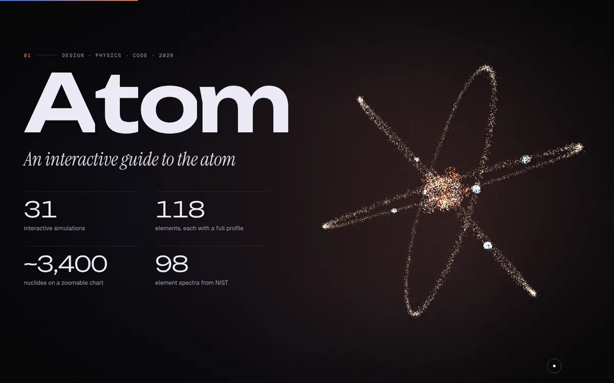
      <h3>⚛️ Atom</h3>
      An interactive guide to the atom: 7 chapters, 4 tools and 31 live simulations computed from real physics, with data from NIST, the IAEA and PubChem.
      <br><br>
      <a href="https://github.com/TheAnomality/Atom-Anomality">Source</a> · served at <code>/atom/</code>
    </td>
    <td width="50%" valign="top">
      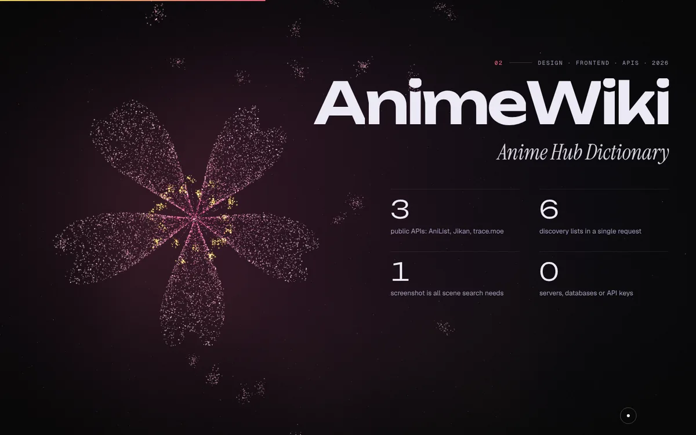
      <h3>🌸 AnimeWiki</h3>
      Anime Hub Dictionary: search anime, manga and characters, see what's trending, or identify an anime from a single screenshot. No server, no API key.
      <br><br>
      <a href="https://github.com/TheAnomality/AnimeWiki">Source</a> · served at <code>/animewiki/</code>
    </td>
  </tr>
</table>

Both are copied in from their own repositories by `npm run sync:projects`, which records the exact commits in `projects.lock.json`. Update a project, run the sync, push, and the portfolio redeploys with the new version.

## Screenshots

<table>
  <tr>
    <td width="33%">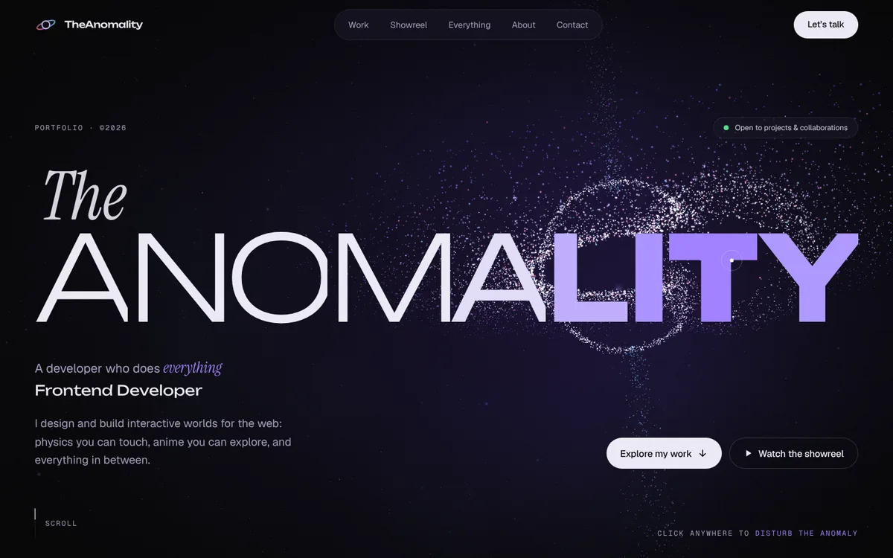</td>
    <td width="33%">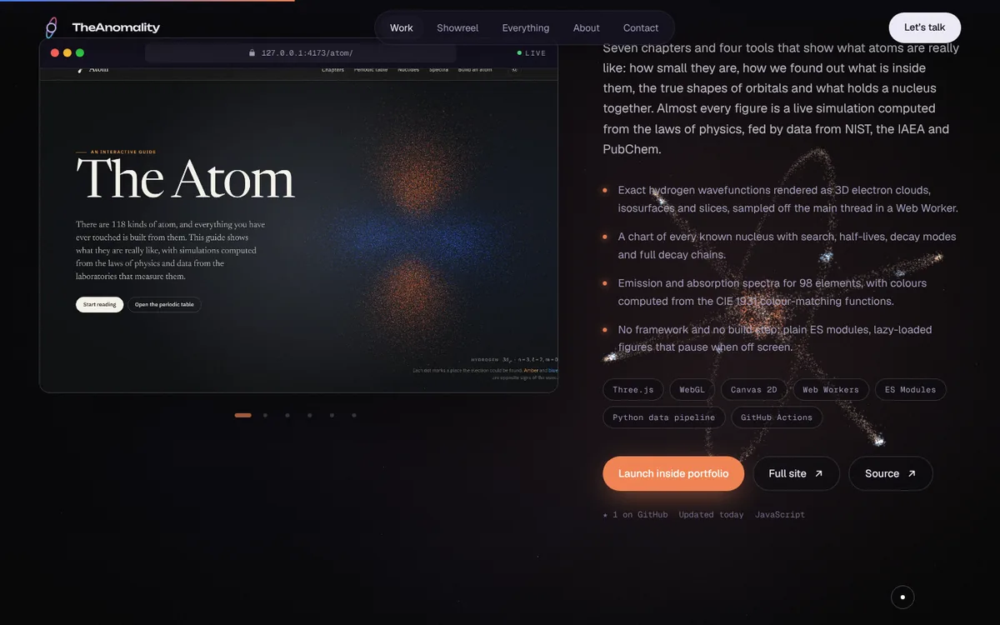</td>
    <td width="33%">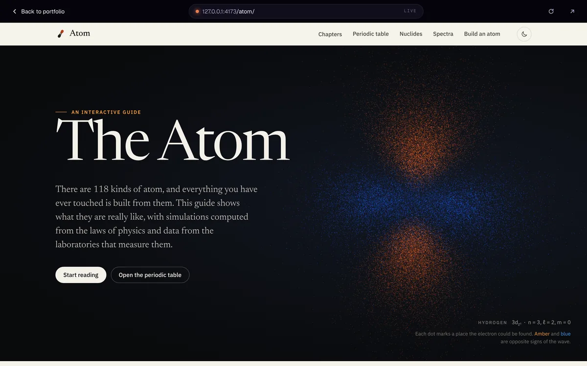</td>
  </tr>
  <tr>
    <td align="center"><sub>Letters react to the cursor</sub></td>
    <td align="center"><sub>Project details and live preview</sub></td>
    <td align="center"><sub>Atom running inside the portfolio</sub></td>
  </tr>
  <tr>
    <td>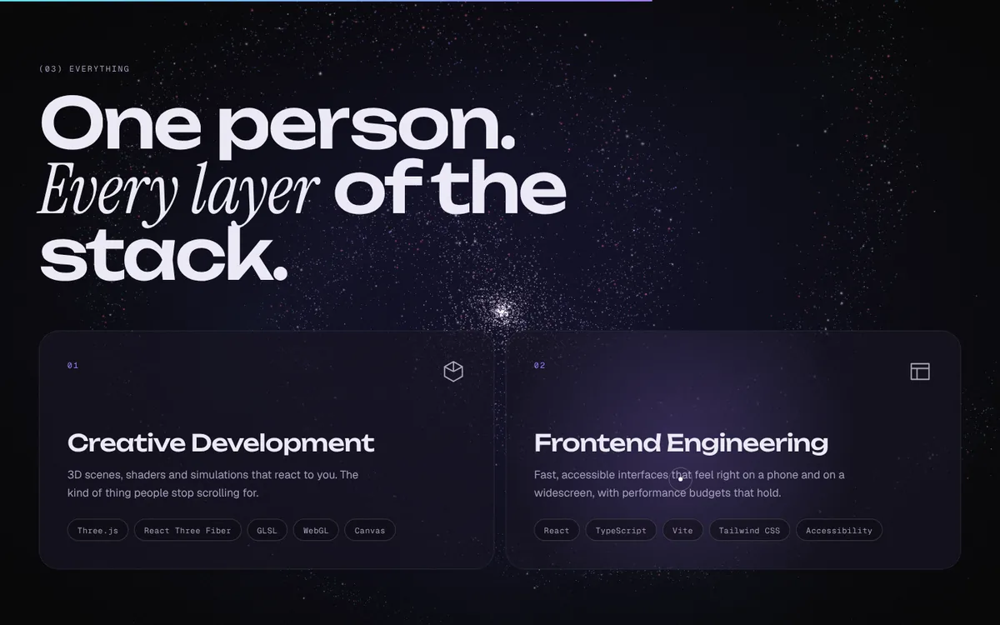</td>
    <td>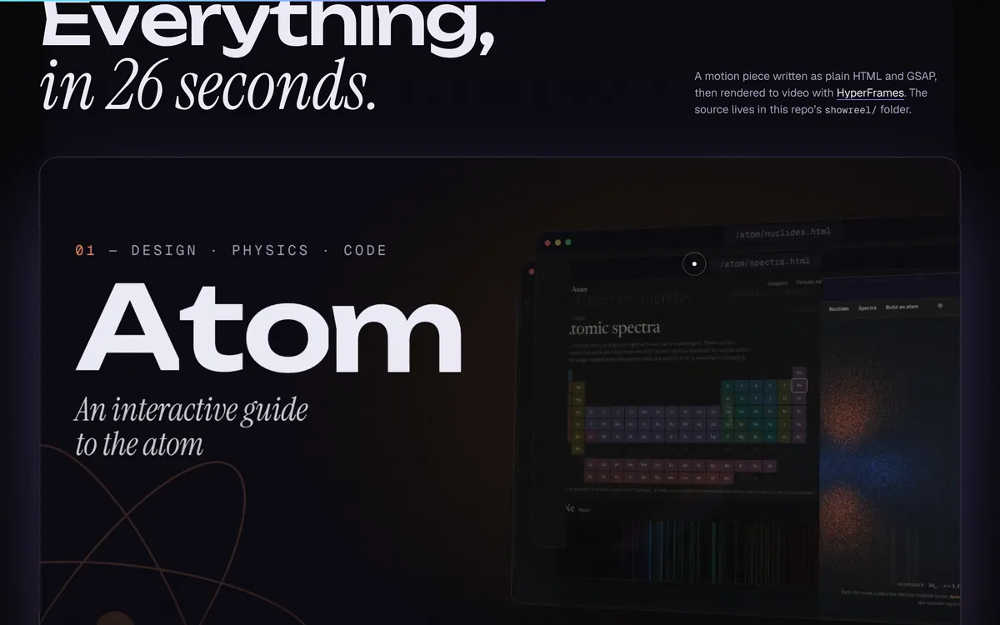</td>
    <td>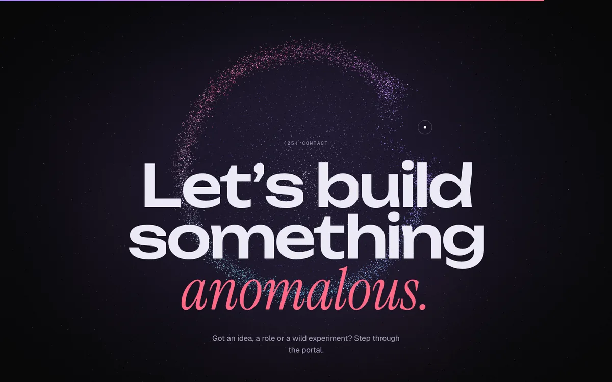</td>
  </tr>
  <tr>
    <td align="center"><sub>Skills, over the galaxy</sub></td>
    <td align="center"><sub>The HyperFrames showreel</sub></td>
    <td align="center"><sub>The portal around the contact section</sub></td>
  </tr>
</table>

<p align="center">
  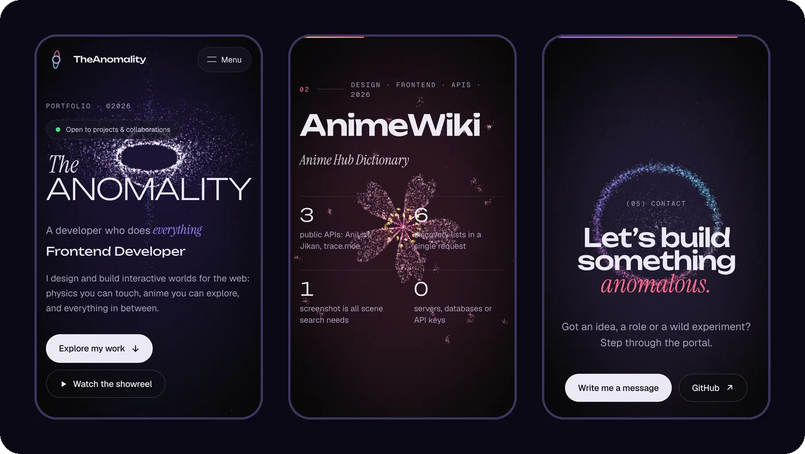
  <br>
  <sub>On phones the scene dims and moves behind the text, with fewer particles for smooth scrolling.</sub>
</p>


## Tech stack

| Layer | Tools |
| --- | --- |
| **App** | React 19, TypeScript (strict), Vite 8 |
| **3D** | Three.js, React Three Fiber, custom GLSL shaders, drei `PerformanceMonitor` |
| **Animation** | Motion (Framer Motion), Lenis smooth scrolling |
| **Styling** | Tailwind CSS v4 with design tokens, self-hosted Unbounded, Geist and Instrument Serif |
| **State** | Zustand |
| **Video** | HyperFrames (HTML + GSAP → MP4), FFmpeg |
| **Hosting** | Vercel: static site, a Function for the contact form, Web Analytics and Speed Insights |
| **Email** | Resend |

## Quick start

You need [Node.js](https://nodejs.org) 22 or newer.

```bash
git clone https://github.com/TheAnomality/Portfolio.git
```

```bash
cd Portfolio
```

```bash
npm install
```

```bash
npm run dev
```

Then open http://localhost:5173.

<details>
<summary><b>All commands</b></summary>
<br>

| Command | What it does |
| --- | --- |
| `npm run dev` | Dev server with instant reload |
| `npm run build` | Production build into `dist/` |
| `npm run preview` | Serve the production build locally |
| `npm run check` | TypeScript type check |
| `npm run sync:projects` | Copy the latest Atom and AnimeWiki from GitHub into `public/` |
| `npm run showreel:preview` | Open the HyperFrames preview to edit the showreel |
| `npm run showreel:render` | Render the showreel and update `public/media/showreel.mp4` |

</details>

## Deploy to Vercel

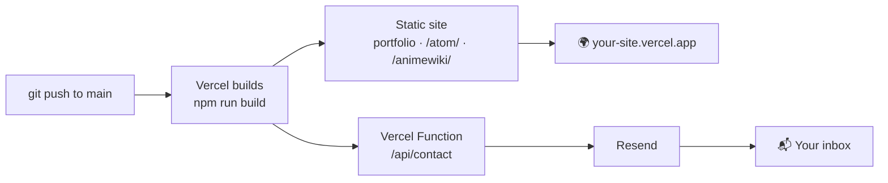

1. **Import:** at [vercel.com/new](https://vercel.com/new), sign in with GitHub, pick this repository and click **Deploy**. The settings are detected automatically and also live in `vercel.json`.
2. **Contact form:** add `RESEND_API_KEY` and `CONTACT_TO_EMAIL` under **Settings → Environment Variables**, then redeploy.
3. **Optional:** add a custom domain under **Settings → Domains**, and switch on **Analytics** and **Speed Insights**.

Every push to `main` goes live, and other branches get their own preview URL. The full walkthrough, including the custom domain, the contact form and a troubleshooting table, is in **[docs/DEPLOY-VERCEL.md](docs/DEPLOY-VERCEL.md)**.

## Make it yours

Almost everything lives in **[`src/content/site.ts`](src/content/site.ts)**. Save it and the page updates instantly.

| To change… | Edit |
| --- | --- |
| Name, roles the hero cycles through, intro, manifesto | `name`, `roles`, `heroIntro`, `manifesto` |
| Projects: text, stats, highlights, screenshots | `projects` (images go in `public/media/<id>/`) |
| Skills cards and the scrolling ticker | `capabilities`, `marquee` |
| About text, facts, "right now" list | `about` |
| Social links and public email | `socials`, `email` |
| Colours, fonts, spacing | `src/styles/index.css` (the `@theme` block) |
| The showreel | `showreel/index.html`, then `npm run showreel:render` |

To add another project, add its repository to `scripts/sync-projects.mjs`, run `npm run sync:projects`, add an entry to `projects` and a redirect to `vercel.json`.

<details>
<summary><b>Project structure</b></summary>
<br>

```
├── src/
│   ├── content/site.ts      ← all text, links and projects
│   ├── App.tsx              page layout
│   ├── sections/            Hero, Manifesto, Work, Showreel, Capabilities, About, Contact, Footer
│   ├── components/          Preloader, Cursor, Nav, ProjectViewer, shared UI
│   ├── three/               shapes.ts · shaders.ts · Scene.tsx (the WebGL world)
│   ├── lib/                 state (zustand), hooks, smooth scrolling
│   └── styles/index.css     Tailwind theme and design tokens
├── public/
│   ├── atom/ · animewiki/   the two projects (npm run sync:projects)
│   └── media/               screenshots, preview loops, showreel
├── api/contact.js           contact form → email (Vercel Function)
├── showreel/                HyperFrames composition for the showreel
├── scripts/                 sync-projects.mjs · render-showreel.mjs
├── docs/                    deployment guide and README images
└── vercel.json              redirects, caching and security headers
```

</details>


## Credits

- **3D:** [three.js](https://threejs.org) and [React Three Fiber](https://r3f.docs.pmnd.rs) (MIT)
- **Animation:** [Motion](https://motion.dev) (MIT), [Lenis](https://lenis.darkroom.engineering) (MIT), [GSAP](https://gsap.com) (GreenSock standard licence) in the showreel
- **Video:** [HyperFrames](https://hyperframes.heygen.com) by HeyGen (Apache 2.0)
- **Fonts:** Unbounded, Geist, Geist Mono and Instrument Serif (SIL Open Font License)
- Atom and AnimeWiki keep their own credits and data-source notes in their folders.

The code is released under the [MIT licence](LICENSE).

<p align="center">
  <br>
  <sub>Built from scratch by <a href="https://github.com/TheAnomality">TheAnomality</a>, with a lot of curiosity.</sub>
</p>
